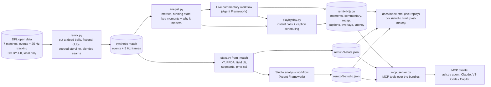
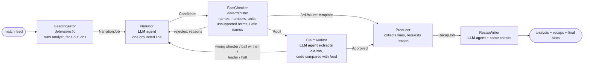
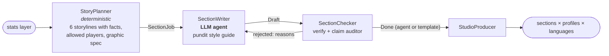
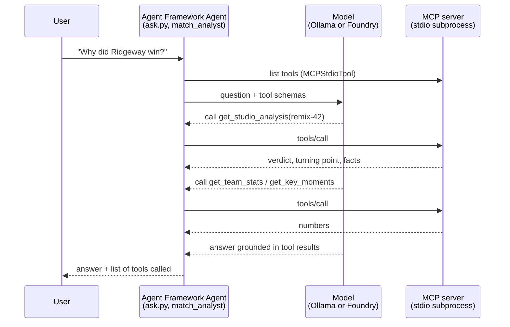
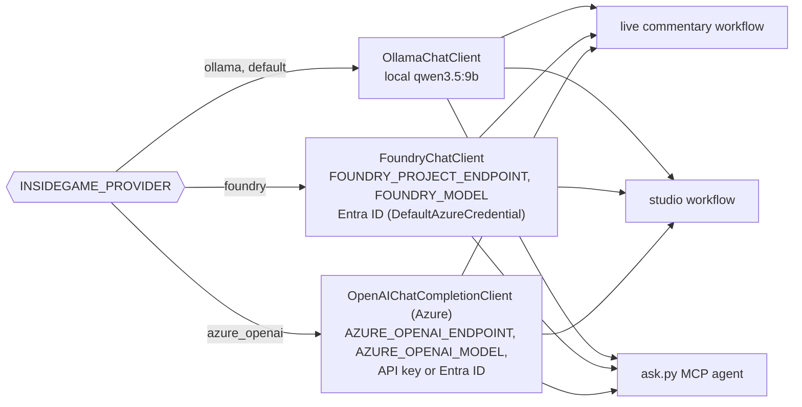

# Inside the Game: architecture

Inside the Game turns a football match feed into commentary that is personalised (casual fan or analyst, English or Chinese) and fact-checked. Every number and name a viewer sees can be traced back to an event in the feed. The submitted matches are synthetic: fictional clubs and players, with movement stitched from real open tracking data.

The system has four layers:

1. **Data**: DFL open data is remixed into synthetic matches.
2. **Deterministic analysis**: the analyst, the stats layer and play-by-play. No model is involved.
3. **Two Microsoft Agent Framework workflows**: live commentary and post-match studio analysis. LLM agents write, a deterministic checker and an LLM claim auditor verify, and rejected text is retried or replaced by a template.
4. **Delivery**: JSON bundles feed static pages and an MCP server, and any MCP client or Agent Framework agent can query the server.

## Data flow



| Stage | Module | Notes |
|---|---|---|
| Source adapter | `insidegame/dfl.py` | Reads one DFL match into the pipeline format. Event locations come from the tracked ball, so events and positions share one frame. |
| Synthetic match | `insidegame/remix.py` | A seeded stitcher (see `DATA_PLAN.md`). Real names never reach the output. |
| Analyst | `insidegame/analyst.py` | Causal: a value for an event uses only that event and earlier ones. Each moment keeps the IDs of the events behind every fact. |
| Stats layer | `insidegame/stats.py` | Full-match and per-segment team and player statistics, with definitions. |
| Play-by-play | `insidegame/playbyplay.py` | One speaker. Urgent calls cut in, and analysis lines enter only once they would really be ready. Analysis that play has overtaken is dropped. |
| Bundles | `insidegame/build.py`, `live.py`, `studio.py` | Write `docs/synthetic/*.json`. |
| Model provider | `insidegame/providers.py` | `get_client()` returns an Agent Framework chat client: Ollama, Microsoft Foundry or Azure OpenAI. |
| MCP server | `insidegame/mcp_server.py` | Seven read-only tools over the bundles. |
| Q&A agent | `insidegame/ask.py` | An Agent Framework agent that answers questions by calling the MCP tools. |

## Workflow 1: live commentary (`insidegame/agents.py`)

Each key moment is narrated for every viewer variant (2 profiles × 2 languages). The live runner (`live.py`) starts one workflow run per moment and variant as soon as the moment is known, and times it until the line has passed both checks. The measured time places the line on the caption track.



- **Two kinds of check.** The fact checker (`verify`) is pure code: it rejects a line that names an uninvolved player, uses a number or measurement that is not in the facts, uses a term the facts do not support (for example "header" or "goalkeeper"), or translates names into Chinese characters. The claim auditor only asks a model to *extract* four claims (shooter, ball winner, leading team, half). Code then compares them with the feed, so the model never judges itself.
- **Every moment always gets commentary.** After three failed attempts a template line is used. The bundle records which path produced each line (`agent:<model>` or `template_fallback`), how many attempts it took and the rejection reasons.

## Workflow 2: studio analysis (`insidegame/studio.py`)



The six storylines are verdict, turning point, momentum, tactical battle, "did they deserve it?" and standout performers. The pundit style guide was written by the team, and no broadcast transcripts are copied.

## MCP server and agent Q&A

`insidegame/mcp_server.py` uses the official MCP Python SDK (`MCPServer`, stdio transport). It is read-only and never calls a model. Every answer is either a fact from the feed or a text that has already passed the checks.

| Tool | Returns |
|---|---|
| `list_matches()` | ids, teams, final score, length |
| `get_match_state(match_id, minute)` | score and running team stats at that minute, last event |
| `get_key_moments(match_id, kind?, lang?)` | moments with key fact, why it matters, score after |
| `get_player_stats(match_id, player?, team?, sort_by?, limit?)` | player rows, filtered or top-N by any numeric field |
| `get_team_stats(match_id)` | team table, 6 segments, goals, shots, metric definitions |
| `get_commentary(match_id, profile, lang)` | checked lines per moment + recap, with their source |
| `get_studio_analysis(match_id, profile, lang)` | the six studio sections with the facts they were checked against |



```bash
.venv/bin/python -m insidegame.mcp_server                      # stdio server for any MCP client
.venv/bin/python tests/mcp_client.py                           # scripted MCP client: list + call tools
.venv/bin/python -m insidegame.ask "Why did Ridgeway win?"     # agent answers with the MCP tools
```

The same server can be registered in any MCP host, for example a VS Code `mcp.json` entry with `"command": ".venv/bin/python", "args": ["-m", "insidegame.mcp_server"]`. GitHub Copilot agent mode can then query the matches.

## Where Microsoft Foundry plugs in

All agents take an Agent Framework chat client. `insidegame/providers.py` chooses one from environment variables, so prompts, executors and checkers are identical across providers:



- The agents pass Ollama-style options (`think`, `response_format="json"`). For the cloud clients, a chat middleware (`portable_options`) drops `think` and maps `"json"` to a JSON-object response format.
- **Status:** the Foundry and Azure OpenAI paths are implemented with the official `agent-framework-foundry` and `agent-framework-openai` packages. They are unit-tested for configuration and construction, and they fail with a clear message when variables or credentials are missing. They have **not** been run against a live Foundry project yet, because the team has no Azure subscription during development. Everything shown in the demo ran on local Ollama.
- **Next steps once a subscription exists:** run the live workflow on a Foundry deployment to compare latency and first-try pass rate with local Ollama, using the stored `latency` and `pipeline` blocks. Use Foundry evaluations and tracing (Agent Framework emits OpenTelemetry spans) on the checker rejection reasons.

## Engineering

- `tests/`: pytest suite that needs no model. It covers the fact checker rules, analyst metrics and causality on a seeded synthetic match, caption scheduling invariants, stats-layer consistency with the bundles, the MCP tools in process and over stdio, and provider selection. Known defects are recorded as `xfail` tests, so a fix flips them to passing.
- `.github/workflows/ci.yml`: installs `requirements.txt` and runs the suite on every push and pull request.
